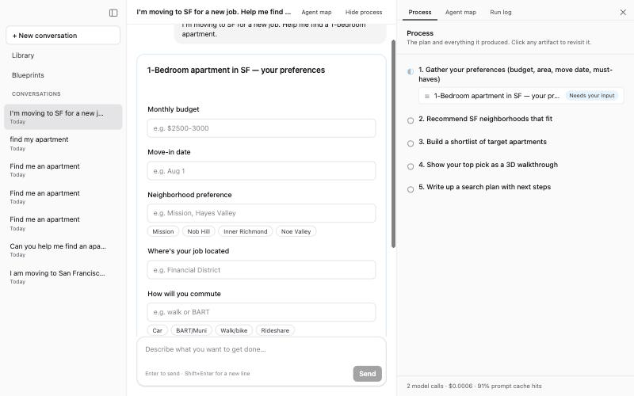
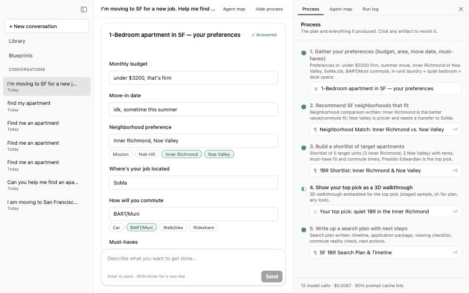

# The Recursive Agents Hackathon

Our entry for the Crusoe × Cerebral Valley Recursive Agents Hackathon (Oct 17, 2026): a team of agents you can walk away from, built on Crusoe Managed Inference.

## Demo: Workbench

A real run on Crusoe (`zai-org/GLM-5.3-Flash` agent, `deepseek-ai/Deepseek-V4-Flash` sub-agents). Listings and 3D rooms are staged samples, not live data.

**1. Ask.** One sentence becomes a plan and a short inline form. Every answer is free text, so "idk" always fits.


**2. Answer.** The agent works through its plan: a neighborhood comparison, a shortlist, a staged 3D walkthrough embedded in the chat, and a search plan. The whole run took 13 model calls, cost $0.0067 and hit the prompt cache 80% of the time.



**3. Change your mind.** Edit an answer in place. Everything built from it is marked out of date, and the agent decides whether the change is small (patch it with sub-agents) or large. Here the budget drop is large, so it asks first, showing a cost and time estimate, then redoes the work, including a new top pick.



## Layout

| Path | What |
|---|---|
| `frontend/` | SvelteKit app (UI and server-side agent code) |
| `formloop/` | Self-improving apartment intake form: renter simulator, recommender agent, reviewer agent, held-out eval, two-pane demo (see its `README.md`) |
| `research/` | Research-owned inputs the form loop loads at runtime: question bank, simulated renters, eval config, design notes |
| `results/` | Held-out evaluation tables written by `formloop` |
| `docs/api.md` | Workbench API reference: endpoints, run stream events, data shapes |
| `docs/cozy-implementation-plan.md` | Planned room designer: parallel workstreams C0–C3, shared contracts, project integration gates, and acceptance tests |
| `docs/research/` | Team research: a build-our-own Obsidian, Blender with GPT-6 Astra and Claude, SF buildings in 3D, floorplans, building energy simulation (start with its `README.md`) |
| `.claude/skills/` | Claude Code skills, including the Crusoe inference reference |
| `CLAUDE.md` | Instructions for Claude Code agents working in this repo |

## Setup

Everyone runs the same toolchain: **Node 24.22.0**, which bundles npm 11.19.1. On any other version, npm refuses to install or run the project's scripts.

macOS / Linux, with [nvm](https://github.com/nvm-sh/nvm):

```bash
nvm install          # reads .nvmrc at the repo root
nvm use
cd frontend
npm ci
[ -f .env ] || echo "DATABASE_URL=local.db" > .env   # mock agent until: npm run set-key
npm run db:push      # create the local SQLite database
npm start            # http://localhost:5173
```

Windows, with [nvm-windows](https://github.com/coreybutler/nvm-windows), which does not read `.nvmrc`:

```powershell
nvm install 24.22.0
nvm use 24.22.0
cd frontend
npm ci
if (!(Test-Path .env)) { Set-Content .env "DATABASE_URL=local.db" }
npm run db:push
npm start
```

[fnm](https://github.com/Schniz/fnm) also works: run `fnm use` from the repo root.

## Commands (from `frontend/`)

- `npm ci`: install the exact locked dependencies
- `npm start`: dev server at http://localhost:5173
- `npm run build`: production build to `build/` (run with `node build`)
- `npm run check`: type checking
- `npm test`: unit tests (Vitest)
- `npm run lint` / `npm run format`: Prettier
- `npm run db:push`: apply the Drizzle schema to the local SQLite database

Use these npm scripts rather than `npx`. Only npm commands check the Node version.

## Dependencies

- `npm ci` installs exactly what `package-lock.json` lists. Use it for every fresh install.
- To add a package, run `npm install <pkg>`, then commit both `package.json` and `package-lock.json`.
- Never delete or regenerate `package-lock.json`. It records the native binaries for macOS, Linux and Windows.
- Dependency install scripts are blocked through `allowScripts` in `frontend/package.json`; the current packages ship prebuilt binaries and don't need them. If a new dependency really needs its script, review it and run `npm install-scripts approve <pkg>`.

## Crusoe API key

Each of us uses our own key from the [Crusoe Console](https://console.crusoecloud.com) (Intelligence Foundry → Inference → Create API Key; it is shown only once). From `frontend/`:

```bash
npm run set-key   # paste the key at the hidden prompt; writes frontend/.env
npm run models    # verifies the key and the configured model IDs
```

Then restart the dev server. Without a key the app runs a scripted mock agent.

Don't edit the key into `.env` by hand: keys can contain `$`, and Vite expands `$name` in `.env` values even inside single quotes, which silently corrupts the key (401/403). `set-key` writes each `$` as `\$`. Never commit the key or put it in frontend code: anything in the browser bundle is public. Details are in section 3 of `.claude/skills/crusoe-recursive-agents-hackathon/SKILL.md`.

## For researchers

The form loop reads everything it learns from in `research/`, so you can change it without touching code:

- `question_bank.yaml`: the seed questions.
- `personas.yaml`: simulated renters with hidden preferences and form-filling habits.
- `eval_config.yaml`: batch sizes, friction weight, questions shown and the random seed.
- `NOTES.md`: your findings. The reviewer agent reads this file every time it proposes a new form version.

Files are validated on load, and errors name the file and the entry. One command each, from `formloop/`:

```
npm run validate     # check the research files
npm run generation   # one outer-loop generation: reactions -> reviewer -> acceptance test on fresh renters
npm run eval         # held-out renters: form v1 vs the latest version, table saved to results/
```

Details are in [`formloop/README.md`](formloop/README.md).

## Working with Claude Code

- `CLAUDE.md`, `.claude/skills/` and `.claude/settings.json` are committed, so every collaborator's agent gets the same instructions, skills and permission allowlist. The allowlist covers only safe commands: install from the lockfile, build, type-check, test, lint and read-only git.
- Put personal settings in `.claude/settings.local.json`, which is gitignored.
- Each of us edits `CLAUDE.md` on our own branch, so the copies drift. A SessionStart hook (`.claude/hooks/main-drift.mjs`) fetches `origin/main` when a Claude session starts and warns if main has `CLAUDE.md` or `.claude/` changes your checkout lacks. When you see it, pull main or rebase onto it. Docs and the code they describe sync when the branch merges into main, so merge small and often.
