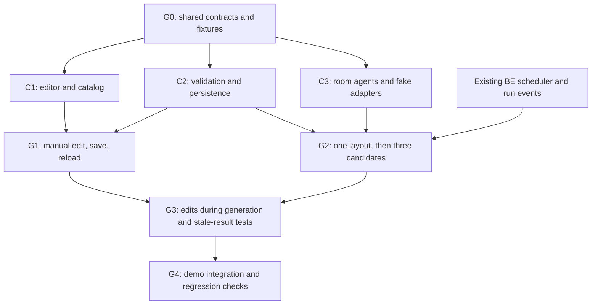

# Cozy-inspired room designer: implementation preparation

Prepared 2026-10-17; updated for parallel delivery and project synchronization. Status: planned, not implemented. Repository baseline: `2971ff1` plus the current working tree.

## Product and source evidence

Build a room-design experience inside the existing Workbench: describe a room, compare three proposed layouts, choose one, move furniture yourself, lock what should stay, and ask agents to refine the rest.

The [original LinkedIn post](https://www.linkedin.com/posts/chua-jun-yu_i-built-cozy-with-shelia-teo-yesterday-at-ugcPost-7505156696961622016-3OEJ/) could not be fetched directly. Its text was retrieved through [Shelia Teo's public repost](https://sg.linkedin.com/in/shelia-teo). The creator describes five capabilities: IKEA models with product dimensions, manual edits and locks that steer Astra while it works, three concurrent design previews, movable windows and lighting, and reflecting mirrors. These are creator claims; the running application and its implementation were not inspected. The [demo short link](https://lnkd.in/gs7D9-u4) did not resolve through the research tool.

Our proposed architecture below is an adaptation to this repository, not a description of Cozy's internals. Assume this extends Workbench and the existing home-search story. It does not replace the team's current priority list in [possible-technical-features.txt](possible-technical-features.txt).

## Scope and build order

| Priority | Deliverable | Completion criterion |
|---|---|---|
| P0 | One rectangular room as a typed, versioned artifact | Open, edit, save, reload, and inspect an earlier version |
| P0 | Furniture placement, rotation, selection, locks | User can arrange a room without any model calls; agent cannot change locked items |
| P0 | One agent proposes a valid layout | Output passes schema, room-boundary, catalog, and collision checks before saving |
| P1 | Three independently generated alternatives | Branches finish independently; choosing one is explicit and cannot overwrite newer edits |
| P1 | Steering during generation | User edits save while generation runs; obsolete agent proposals never overwrite them |
| P1 | Curated real furniture assets | Several verified models render at measured dimensions; failed assets have labeled proxies |
| P2 | Window editing, day/evening presets, one mirror | Openings remain valid; mirror actually reflects; quality can be reduced on slower devices |
| Later | Imported floorplans, arbitrary polygons, multi-room scenes, photorealistic lighting | Separate scope after the editing and generation loop is reliable |

Start with procedural furniture and deterministic offline generation. Real assets improve the result but should not block interaction and concurrency work. Keep product prices, inventory, room reconstruction from photographs, and physical daylight simulation outside this first implementation.

The current team backlog records a 4 PM freeze and 5 PM submission. Full Cozy parity is a multi-stage effort, not a safe small addition to that cut. If time is short, ship the P0 slice and label subsequent capabilities as pending. Reassess after the editor and conflict-handling spikes; do not promise all phases for today's demo.

## Repository fit and verified gaps

| Existing code | Reuse | Required change |
|---|---|---|
| `frontend/src/lib/types.ts` | Shared artifact and stream types | Add `room_scene`, typed scene mutations, and branch progress events |
| `frontend/src/lib/server/db/schema.ts` | Artifacts, versions, lineage, usage | Unique artifact/version constraint; mutation receipts and branch run records |
| `frontend/src/lib/server/store.ts` | Conversation-scoped reads, persistence, downstream invalidation | Transactional compare-and-swap writes; current `addVersion` reads then writes without an expected-version guard |
| `frontend/src/lib/components/ArtifactView.svelte` | Artifact navigation and version selection | Dedicated room renderer; meaningful scene diffs; historical versions read-only |
| `frontend/src/lib/components/Workspace.svelte` | Chat, process, `?a=<id>` links | Expanded scene workspace and comparison view |
| `frontend/src/lib/server/agent/run.ts` | Existing loop, cancellation, stream, usage | Scene-specific orchestration and steering checkpoints; currently only consecutive `quick_edit` calls fan out |
| `frontend/src/lib/server/agent/subagent.ts` | Model-call plumbing | Separate scene generator; existing helper returns full markdown/HTML, unsuitable for geometry mutations |
| `frontend/src/routes/api/conversations/[id]/run/+server.ts` | Chat run entrypoint | Separate mutation endpoint: this route currently returns 409 for all edits while running |
| `frontend/src/lib/client/run.svelte.ts` | Streaming and invalidation | Branch status plus editor reconciliation that preserves unsaved local changes |
| Artifact cards, process panel, library, mock agent, `docs/api.md` | Discovery and offline demo | Add the new artifact kind everywhere it is enumerated or rendered |

`frontend/package.json` has no three.js dependency. Add `three` and compatible types through npm when implementation starts, retaining the lockfile. Use the pinned Node/npm environment. No framework migration is needed.

## Scene contract

Keep the canonical scene as validated JSON in `artifact_versions.content`. The existing artifact version is its revision; avoid a second independently incrementing revision field. Treat persisted JSON as untrusted until validated, including agent output.

```ts
type RoomScene = {
  schemaVersion: 1;
  units: 'm';
  room: { width: number; depth: number; height: number };
  openings: Array<{
    id: string;
    wall: 'north' | 'east' | 'south' | 'west';
    kind: 'door' | 'window';
    offset: number; width: number; height: number; sill: number;
  }>;
  furniture: Array<{
    id: string;
    catalogId: string;
    position: [number, number, number];
    rotationY: number;
    locked: boolean;
  }>;
  lighting: { preset: 'day' | 'evening' };
};

type SceneMutation = {
  mutationId: string;
  baseVersion: number;
  operations: SceneOperation[]; // closed discriminated union, specified in phase 1
};
```

Coordinates: room interior is `x ∈ [0,width]`, `z ∈ [0,depth]`, floor `y=0`, +Y up. Furniture position is its bottom-center pivot; yaw uses radians. North is `z=0`; wall offsets measure from a documented start corner along each wall. Convert existing 2D floorplan `(x,y)` to scene `(x,-z)` explicitly at the import boundary, following the [floorplan research](research/floorplan-2d-to-3d.md).

Catalog entries own dimensions, asset URLs, model-to-metre scale, pivot correction, category, and collision footprint. Agents choose catalog IDs, never arbitrary URLs or resize factors. Start with floor-supported furniture, and allow intentional footprint overlap only for declared categories such as a rug beneath a table. Rotation-aware footprints must stay within the room and clear of door access zones. Clearance values are design heuristics, not building-code compliance claims.

Scene operations should cover add, move, rotate, remove, user lock/unlock, lighting changes, and later opening edits. Reject non-finite numbers, unknown IDs, duplicate IDs, excessive item counts, invalid openings, and unsupported schema versions. The server derives the actor from the request/tool context; clients cannot claim agent or privileged identity. Agent operations cannot unlock objects or change, replace, or delete locked furniture. Manual movement requires explicitly unlocking first.

## Renderer and asset pipeline

Use a lazy browser-only Svelte component backed by plain three.js. Reuse the segmented-wall approach from the floorplan research, avoiding CSG for rectangular openings. Keep scene data independent of GPU objects and renderer lifetime.

- Camera: orbit plus a top-down view. Furniture: raycast selection and [TransformControls](https://threejs.org/docs/pages/TransformControls.html), restricted to floor translation and yaw. Disable camera orbit during object dragging; provide numeric and keyboard alternatives.
- Models: [GLTFLoader](https://threejs.org/docs/pages/GLTFLoader.html) for curated GLB files, with bounded asset sizes and a shared cache. Normalize pivot and scale once during ingestion; verify bounding dimensions against catalog metadata.
- Lighting: modest ambient/daylight and warm evening presets. These are visual modes, not accurate solar simulation.
- Mirrors: use one [Reflector](https://threejs.org/docs/pages/Reflector.html) for the initial planar mirror. Budget its additional rendering work and expose a reduced-quality mode.
- Lifecycle: resize with the container; dispose controls, geometry, materials, textures, image bitmaps, render targets, and listeners with clear ownership for cached/shared assets. Cancel rendering after unmount.
- Alternatives: thumbnail previews plus one active interactive canvas; do not keep three full render loops running just for comparison.

Render scenes in code-owned components. The existing HTML-artifact iframe disallows network access; do not weaken its CSP to load furniture or execute agent-written three.js code.

Asset preparation: create a small manifest with catalog ID, source/product URL, measured dimensions, units, local asset path, provenance/reuse status, and last verification date. The post establishes that its creators extracted IKEA models; it does not establish a supported public API or permission for our redistribution. Verify access and reuse for each candidate before relying on it. Use original procedural models or explicitly reusable assets when that is unresolved. Label proxy geometry clearly. Do not implement bulk product scraping as a prerequisite.

## Concurrency and steering protocol

This is the highest-risk part of the implementation. A prompt asking agents to respect locks is insufficient.

1. Start generation from an immutable input scene and its artifact version. Give every branch its own ID and snapshot; branches never share a mutable scene object.
2. A drag updates local state immediately. On release, submit one mutation with `baseVersion` and a unique `mutationId`. Lock and numeric edits use the same path. Avoid storing a version for every pointer movement.
3. In one database transaction, validate conversation ownership, check the expected version and locks, apply validated operations, insert the next artifact version, update the head, record the mutation receipt, and mark affected descendants stale. An existing receipt returns the original outcome on retry.
4. A version mismatch returns 409 plus the latest revision. Preserve the local draft, display the conflict, and allow retry against the refreshed scene. For the first implementation, reject the whole stale operation batch; do not silently merge partially conflicting geometry.
5. Save user edits even while model calls run. Write steering notifications to a dedicated queue/table; the orchestrator drains them at safe checkpoints and appends a compact scene delta plus current version to history after any outstanding tool results. Preserve assistant/tool message ordering.
6. Before publishing an agent result, compare its captured input version with the latest scene. A stale proposal is discarded or explicitly shown as outdated; it never changes the active scene. Replan from the current snapshot, with a bounded retry count. Recheck at the final transaction to close the last race.
7. First support steering between model/tool steps. An optional later optimization aborts obsolete branch requests and restarts after edits settle. Cancellation must still discard late responses; do not assume aborting a fetch cancels provider billing. Do not claim provider-native mid-token steering: the current client has no such implementation.
8. Selecting an alternative also requires a version check. Clone the chosen candidate into a new active-scene version with recorded branch provenance; keep other alternatives available. A stale candidate must be regenerated or reviewed against the current scene before use.

Keep one orchestrator per conversation. Generate three alternatives through a shared bounded scheduler (initial concurrency 2, configurable to 3 after checking available capacity), using the existing per-model retry/throttle behavior. “Three alternatives” does not promise all three start simultaneously. Persist queued/running/succeeded/failed/cancelled branch status, input version, output artifact, usage, and parent run ID. Recover partial successes if a sibling fails. On server restart mark unfinished work interrupted; durable background job resumption is later scope.

For reload/reconnection, fetch persisted scene and branch state through the conversation API and poll while a job is active. The current NDJSON stream only belongs to the initiating client; it is not a reconnectable event log. Add replayable events later if needed.

Suggested tools: `read_room`, `search_furniture`, `propose_room_patch`, `generate_room_options`. Agents receive compact catalog records and validated scene state. Geometry checks are deterministic; optional agent critique handles qualitative layout goals. Return validation errors for one repair attempt, then preserve the previous valid scene and report failure. Read the [Crusoe project skill](../.claude/skills/crusoe-recursive-agents-hackathon/SKILL.md) before implementing inference changes and verify configured models with the existing `npm run models` command. No additional model provider is required by this plan.

## API additions to specify before coding

| Proposed endpoint | Input/output | Rules |
|---|---|---|
| `PATCH /api/conversations/[id]/artifacts/[artifactId]/scene` | `SceneMutation` → canonical scene, committed version, mutation ID | Works during a run; 404 outside conversation; 400 malformed; 409 stale; 422 invalid layout/locked operation |
| `POST /api/conversations/[id]/artifacts/[artifactId]/options` | Expected version, brief, request ID → parent run and three branch IDs | One bounded job; idempotent start; no automatic application |
| `POST /api/conversations/[id]/artifacts/[artifactId]/select-option` | Candidate ID, expected active version, mutation ID → new active version | Candidate ownership, input version, locks, and geometry checked transactionally |

Use `GET /api/conversations/[id]` to expose saved branch status alongside artifacts, and extend existing cancellation to propagate to all child requests. Manual scene writes should not start a new model call for each movement; ongoing generation consumes the changes, or the user requests refinement explicitly.

Before adding the unique `(artifact_id, version)` constraint, check an existing database for duplicate versions. Do not silently discard conflicting history. Add migrations only during implementation and verify against a disposable copy rather than mutating the working demo database during preparation.

## Editor flow and responsive behavior

| Task | Desktop | Mobile | Success and recovery |
|---|---|---|---|
| Begin a design | Open room artifact, use default dimensions or enter measurements | Short dimension form then canvas | Room appears immediately; invalid dimensions retain entered values |
| Arrange furniture | Object list, drag handles, properties inspector | Tap object, bottom-sheet position/rotation controls | Immediate preview, saving/saved state; failed save retains draft |
| Generate alternatives | Chat brief and three preview cards beside the scene | Full-width cards with explicit preview/select actions | Each branch shows status; failed branch can retry independently |
| Refine and lock | Move, lock, then request changes in chat | Same actions through visible controls | Locks are visible; feedback says when generation is adapting |
| Revisit work | Existing `?a=<id>` link and version picker | Same deep link, back returns to conversation | History is read-only; restore creates a new version |

Use the canvas as the primary region while designing, with collapsible chat/process details. Keep existing library and artifact navigation. Preserve selected objects and local drafts across stream invalidations. Provide an object list and labeled numeric fields for all essential edits so canvas gestures are optional. Include visible focus, text status announcements, sufficiently spaced touch targets, and reduced-motion support.

Explicit states: empty room with an add-furniture action; catalog/model loading; selected/locked object; saving/saved/unsaved; generating/queued; partial branch failure; outdated proposal; offline draft; WebGL unavailable. Offline edits remain clearly unsaved until reconnection. If WebGL fails, provide the object list and dimensions and preserve saved data; do not present a blank canvas as success.

## Implementation milestones and acceptance tests

These are acceptance milestones, not a requirement that one person implement every stage sequentially. Use the parallel workstreams and integration gates below to execute them.

1. **Scene contract and persistence.** Add `src/lib/room/{types,validate,operations}.ts`, fixture catalog/scenes, and `src/lib/server/room/store.ts`. Write failing tests for malformed scenes, rotation-aware bounds, collision exceptions, locks, wrong-conversation access, stale writes, duplicate mutation retries, and two writes from the same base revision. Verify only one competing write commits and the rejected write creates no orphan version. Add schema/migration work here.
2. **Manual editor.** Add `src/lib/components/RoomSceneView.svelte`, `src/lib/room/three/viewer.ts`, and client scene state. Wire artifact cards/library/version history and the mutation endpoint. Browser acceptance: place → rotate → lock → save → reload; keyboard-only editing; failed save retains draft; artifact switch releases resources. This is the first independently useful deliverable.
3. **One agent, then three options.** Add `src/lib/server/agent/room.ts`, a shared scheduler, branch persistence, offline fixtures, and comparison controls. Tests: valid result commits only when fresh; invalid result gets at most one repair; sibling failure preserves successes; selecting an option leaves the others intact. Validate configured models before a real-provider smoke test.
4. **Steering.** Add scene edit queue/checkpoints and stale-result handling. Integration test with a deferred fake model response: begin generation at v1, manually move and lock a sofa to v2, release the old response, and verify the sofa remains at v2. Repeat with cancellation, a late response, duplicate delivery, and a stale option selection. Inspect message ordering after interrupted tool calls.
5. **Assets and visual polish.** Verify curated models, scaling, proxy fallback, openings, presets, and one mirror. Test a broken GLB URL, unusual model origin, long session, mobile interaction, reduced quality, and WebGL failure. Record actual rendering performance on the demo laptop before adding more effects.
6. **Demo readiness.** Script: describe room → compare alternatives → choose → move and lock sofa → request refinement while it runs → show respected lock → reload/version history. Include a seeded offline scenario and record a backup. Update `docs/api.md`, README, and the feature list to reflect only completed behavior.

## Parallel implementation and project synchronization

Run Cozy as an extension of the current Workbench project. The home-search flow remains usable while room design is developed: shortlist a home → enter or confirm room dimensions → open a room artifact → arrange furniture → compare agent proposals. Link the room artifact to its input form and, when available, the selected-home artifact through existing lineage. Missing room measurements use an explicitly labeled example room; listing data or building footprints do not establish the real interior dimensions.

### Workstreams and ownership

Use one integrator and three implementation workers. Roles below are proposed work assignments, not claims that teammates have accepted them. Gaelan's existing backend tasks retain their current ownership. All paths in this table are relative to `frontend/` unless specified otherwise.

| Lane | Work that proceeds independently after contract freeze | Exclusive implementation files | Handoff |
|---|---|---|---|
| C0 — integrator | Freeze contracts and fixtures; coordinate existing FE/BE work; apply shared-file adapters; integrate and run regression checks | `src/lib/room/types.ts`, `src/lib/room/fixtures/**`; coordinated changes to existing shared files listed below | Published contract revision, integration commits, gate results |
| C1 — scene editor and assets | Render/edit fixture scenes; object selection, movement, locks, dimensions, versions, responsive controls; procedural catalog then verified GLBs | `src/lib/room/three/**`, `src/lib/room/catalog/**`, `src/lib/components/room/**`, `src/lib/components/RoomSceneView.svelte`, `src/lib/client/room.svelte.ts`, `static/models/room/**` | UI accepts a scene snapshot and emits typed operations; no dependency on a live model |
| C2 — validation and persistence | Pure scene validators/reducer; transactional version writes; mutation receipts; isolated database tests; scene mutation endpoint | `src/lib/room/{validate,operations}.ts` and their tests, `src/lib/server/room/**`, new scene mutation and option-selection routes | Tested scene repository and HTTP handlers; schema requirements handed to C0 |
| C3 — room agents | One layout generator, three-option orchestration, repair limits, cancellation, steering checkpoints, deterministic deferred-model tests | `src/lib/server/agent/room/**`, new options-generation route | Generator consumes injected repository/scheduler/model interfaces; returns proposals and progress |

C1 supplies catalog records through the C0-owned catalog type; C2 and C3 can begin against the fixed fixture catalog without waiting for model downloads. C2 owns branch persistence and atomic option selection; C3 owns generation policy. Put proposed `server/agent/room.ts` code from the earlier milestones in `server/agent/room/` to keep these boundaries explicit.

**Shared files have one writer at a time.** C0 integrates changes to `src/lib/types.ts`, `src/lib/server/db/schema.ts`, `src/lib/server/store.ts`, `src/lib/server/agent/{run,tools,prompt,mock,subagent}.ts`, `src/lib/server/crusoe.ts`, `src/lib/client/run.svelte.ts`, `src/lib/components/{Workspace,ArtifactView,ArtifactCard,ProcessPanel}.svelte`, library routes, existing conversation/run/cancel routes, `package.json`, and `package-lock.json`. For files being changed by Gaelan or the active frontend owner, C0 supplies a small adapter request or integrates after their handoff; C0 does not take ownership away from them. Workers provide interfaces and tests instead of independently editing those files.

Only C0 installs shared dependencies and applies schema/migration changes. Database tests use separate temporary databases. No lane uses the working demo database for schema experiments. Each lane reports exact changed paths and contract revision at handoff.

### Gate G0: contracts first, then fan out

Before implementation workers start, C0 publishes the smallest compiling contract and shared fixtures. G0 is a short serial step; renderer, storage, and agent work then overlap.

| Contract | Decisions to freeze | Consumer |
|---|---|---|
| Scene and catalog | `RoomScene`, `CatalogItem`, operation union, units/pivots, lock semantics, catalog IDs, validation errors | All lanes |
| Snapshot and mutation | `SceneSnapshot = { artifactId, version, scene }`; request carries `baseVersion` and `mutationId`; success returns canonical snapshot; conflict returns latest version without dropping local draft | C1/C2 |
| Room repository | `readScene`, `applyMutation`, `createCandidate`, `listCandidates`, `selectCandidate`; actor/provenance from trusted server context; deterministic error codes | C2/C3 |
| Candidate | ID, parent run ID, source artifact/version, output artifact/version, status, error, cost, duration; branch output never silently replaces the active scene | C1/C2/C3 |
| Scheduler adapter | Submit a child task with parent/conversation IDs, role, model and abort signal; obtain progress/result; share admission limits with research and quick-edit work | C3 and existing BE fan-out |
| Agent progress | One common shape for research and room work: run/parent/conversation IDs, role, status, model, optional artifact ID, cost and duration | Existing live-tree FE and C3 |
| Component boundary | `RoomSceneView` receives snapshot, catalog, read-only/saving/error state and an operation callback; existing artifact view owns navigation | C1/C0 |

Use the existing backend's run/event types if they land first; adapt room code to them. If they do not exist yet, freeze provisional interfaces in the room module and keep fake adapters local to tests. Do not publish a second competing global scheduler or event protocol. When research and room generation share capacity, apply limits to actual model requests, not parent orchestration jobs that wait for children; avoid nested semaphore deadlocks.

All scene-writing paths, including generic `update_artifact` and `quick_edit`, must use the validated scene repository or reject `room_scene`. Adding a dedicated endpoint alone does not prevent another tool from bypassing locks and version checks. Lock this requirement at G0.

Fixtures: one empty measured room, one furnished valid room, one locked sofa, one invalid overlap, and three distinct candidate layouts derived from the same version. C1 uses a local save adapter; C2 uses a temporary database; C3 uses a deferred fake model. This permits useful progress without a live endpoint, downloaded furniture, or another lane's completed implementation.

### Integration sequence



| Gate | Integrator verifies before proceeding | Fallback if incomplete at feature freeze |
|---|---|---|
| G0 | Contract compiles; all lanes consume identical fixtures; shared-file ownership recorded | Continue independent design/tests, defer live integration |
| G1 | Place/rotate/lock/save/reload; history; conflict and duplicate-request handling; old artifact kinds still work | Keep room design outside the main demo |
| G2 | Valid single proposal, then three candidates; shared capacity accounting; partial failure; cancellation; explicit selection | Demonstrate manual editor or one successful proposal only |
| G3 | Delayed v1 response cannot overwrite a v2 user edit/lock; stale selection rejected; generic tools cannot bypass checks; unsaved UI state survives invalidation | Disable generation while editing, clearly showing that limitation |
| G4 | Existing home-search/form/edit/redo/library flow and room flow pass together; mock demo works; build passes | Ship the last passing gate and retain the existing home-search demo |

Integrate C2's repository and C1's editor first for G1 while C3 continues independently. Add the single-generator adapter before fan-out, then steering. Real assets, lighting and mirrors can progress within C1 after the manual editor handoff, but are not dependencies of G2/G3. Do not turn an incomplete steering loop into a demo claim.

### Synchronization with current project tasks

| Current backlog task | Cozy integration | Coordination rule |
|---|---|---|
| BE research fan-out / concurrency / model spreading — Gaelan | Reuse task scheduling, cancellation, model selection and rate-limit handling for room branches | One implementation; C3 develops against its interface until BE handoff |
| FE live agent tree | Show research and room children through the same progress contract | Existing tree owner builds the shared view; C1 does not build a separate global tree |
| BE listings and market snapshot | Optional upstream selected-home context | Room editing works without scraped listings; do not block on the dataset |
| FE comparison and visit-feedback flow | Optional “Design this room” entry from a selected home | C0 wires an artifact link after G1; no rewrite of comparison/feedback behavior |
| Existing 3D/floorplan research | Share coordinate conventions and wall rendering approach | Keep room designer as the first bounded slice; imported/real floorplans remain later work |
| Demo recording and pre-run conversation | Add a room segment after G3/G4 | Preserve a passing home-search recording; mark mock or example-room data visibly |

Synchronization is repository-based. It does not imply that teammates have been messaged or that remote branches have been fetched/merged. The backlog was reorganized into FRONTEND/BACKEND/BOTH while preparing this plan; anchor updates to task names rather than line numbers or old numbered items.

### Handoffs and document upkeep

1. At implementation kickoff, record the actual base commit, lane owners and contract revision in the table below. Use separate branches/worktrees for concurrent coding when practical; if sharing a checkout, keep the same exclusive file boundaries. Do not checkout/reset a branch another worker is using.
2. Before changing shared interfaces, C0 re-reads current code, `docs/api.md`, the feature list and the working diff. Check for changes from existing FE/BE work and the document-sync job. Re-read any shared file immediately before patching it.
3. A lane handoff contains: task ID, contract revision, changed files/commit when available, exported interface changes, checks and results, blockers, and the next dependency. C0 integrates small handoffs, resolves conflicts, then publishes a new integration revision for the other lanes.
4. Keep proposed contracts here. `docs/api.md` describes implemented endpoints only; update it in the same integration change that adds working routes/events. Its existing sync process can then verify them against source. Do not mark planned endpoints as available.
5. Add lane status to the feature list using stable C0–C3 IDs. Move only completed, verified functionality to DONE. Preserve Gaelan markers and the current FE/BE structure when the sync job rewrites the file. This plan is the detailed ownership/dependency source; the feature list is the status summary.
6. At integration gates run targeted tests for the changed behavior plus `npm run check`; at G4 run `npm test` and `npm run build` and the manual demo regressions. Re-run checks when integration changes justify them. Planned acceptance tests are not evidence of completed functionality.

| Task | Current state | Starts after | Completion evidence |
|---|---|---|---|
| C0 contracts/integration | Planned; owner unassigned | Implementation kickoff | Contract revision + integration gate results |
| C1 editor/assets | Planned; owner unassigned | G0 | G1 editor checks + asset fallback evidence |
| C2 scene data/API | Planned; owner unassigned | G0 | Transaction/lock/conflict tests + endpoint contract |
| C3 room agents | Planned; owner unassigned | G0; real integration awaits shared BE adapter | Proposal/partial failure/steering tests |

One read-only helper reviewed integration conflicts during planning. No coding workers or ongoing synchronization automation were started.

## Baseline validation and remaining decisions

Preparation checks on 2026-10-17: `npm run check` passed with zero errors/warnings; `npm test` passed all 5 tests in 2 files. These tests cover the existing code, not the proposed room features. No dependencies were installed, database changed, credentials inspected, or model calls made for this preparation.

Defaults above make implementation actionable. Remaining product decisions can be made at their milestone: whether this becomes the main hackathon demo or a follow-on artifact; which real furniture assets are available for reuse; whether strict concurrent execution of all three branches is necessary; and whether floorplan import belongs in the next scope. Begin with G0, then run C1–C3 in parallel while C0 integrates at the gates.
