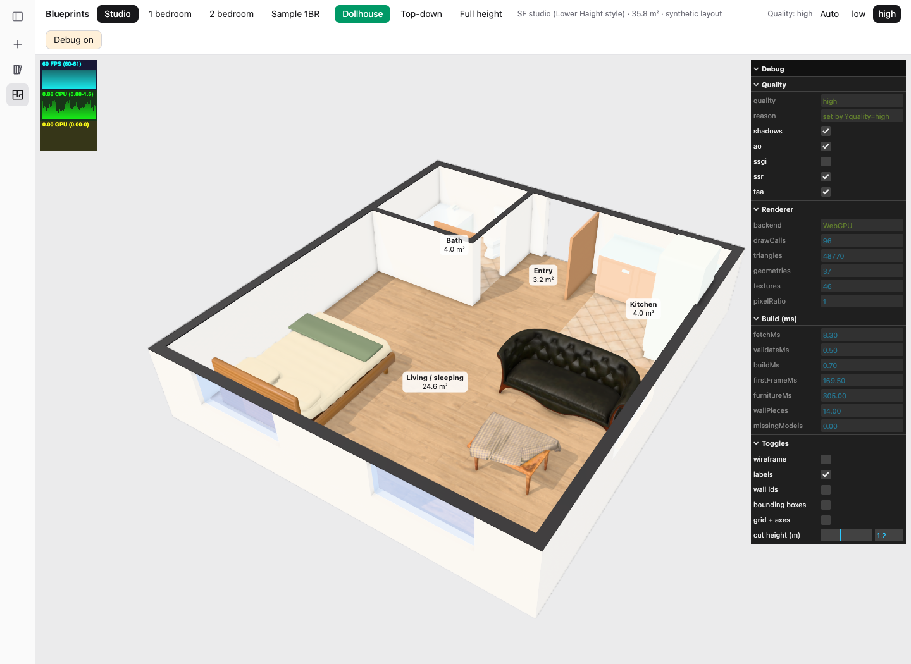

# GLB delivery validation — 2026-10-17

The [model brief](../glb-models.txt) is implemented for all 40 P1/P2/P3 pieces: 30 new GLBs and 10 replacements, plus the retained CC0 leather sofa. Architectural pieces under “Later” remain outside this batch. The original assets total 19,860,788 bytes (19.86 MB) and 202,624 triangles. See the [per-file manifest](../../frontend/static/models/catalog.json) and [credits](../../frontend/static/models/CREDITS.md).

## First-model gate

The queen bed was generated and checked at `/plans?quality=high&debug=1` before generating the other pieces. Chrome rendered the Studio plan using WebGPU, with `missingModels: 0` and no console warnings/errors. The first export was 18,428 triangles / 2.98 MB; subsequent texture optimization reduced the final bed to approximately 1.48 MB without changing its geometry.



## Browser checks

Use the **Furniture collection** selector on `/plans?quality=high&debug=1`. It switches to High quality and Full height for the collection. Direct links below also work; choose Full height to inspect mounted items above the dollhouse wall cut.

| Collection | URL | Observed backend | Missing models | Console errors/warnings |
|---|---|---|---:|---:|
| P1 essentials | `/plans?quality=high&debug=1&plan=models-p1` | WebGPU | 0 | 0 |
| Living room | `/plans?quality=high&debug=1&plan=models-living` | WebGPU | 0 | 0 |
| Dining / kitchen | `/plans?quality=high&debug=1&plan=models-kitchen` | WebGPU | 0 | 0 |
| Bedroom / bath | `/plans?quality=high&debug=1&plan=models-bedroom-bath` | WebGPU | 0 | 0 |

Screenshots: [P1 essentials](p1.png), [living room](living.png), [kitchen](kitchen.png), [bedroom/bath](bedroom-bath.png). These are synthetic display layouts for asset inspection, not real apartments. Visual inspection caught a coplanar cabinet top; the carcass now ends below the countertop, removing that overlap.

Wall art, mirror, wall cabinet, range hood, and towel rail use `h` as **bottom mounting height**, added to the story elevation. Their physical height follows footprint scaling. Pendants use `h` as **top mounting height**. TVs and table lamps retain physical `h` and use optional `base` to sit on a console or nightstand. Existing listing types need no data migration. Low quality continues to use approximate box furniture.

## Automated checks

- The first loader tests failed on floor placement of wall objects, incorrect pendant anchoring, and absent single-bed selection. A tabletop-base test also reproduced the old floor placement before the fix.
- Loader tests now cover bottom/top mounting, story elevation, footprint scaling, tabletop supports, variant selection, forwarding mount metadata through `loadFurniture`, and fallback for unknown types.
- Asset tests inspect all forty GLB containers: one root, correct dimensions and pivot, supported extensions, embedded images, no cameras/lights/animations, triangle/file-size budgets, registry coverage, and valid preview plans.
- Bounds tests caught a 15 mm sofa discrepancy and a small TV discrepancy. The exporter now normalizes actual transformed vertices instead of conservative rotated bounding-box corners.
- `npm run check`: zero errors/warnings. `npm test`: all 118 tests in 12 files passed. `npm run build`: passing; Vite reports the existing large rendering-chunk warning.

Run from `frontend/` with the pinned Node/npm versions:

```sh
npm test -- src/lib/floorplan/three/furniture.spec.ts src/lib/floorplan/three/model-assets.spec.ts
npm run check
npm run build
```

## Reproduction and handoff

The source is [generate-furniture.py](../../frontend/scripts/generate-furniture.py). It creates original geometry and embedded 1k material maps, exports self-contained GLBs without compressed geometry, updates the manifest, and generates the four preview plans. From the repository root:

```sh
/Applications/Blender.app/Contents/MacOS/Blender --background --factory-startup --python-exit-code 1 --python frontend/scripts/generate-furniture.py -- all
```

Replace `all` with model keys for a partial rebuild. Local Blender required execution outside the tool sandbox during this session. Native dimensions in the manifest are width/depth/height; exported glTF is Y up, with front +Z and bottom-center origin except the top-origin pendant.

Laurie's current listing types use the replacements automatically. Adding the new decorative types to `formloop/src/plan3d.ts` is a separate listing-layout change; the preview plans show the required data shapes and support heights. No message was sent to Laurie and that file was not modified.

These models add asset detail; they do not add path tracing or change the lighting system. The mirror is a metallic PBR surface using the viewer's existing reflections, not a new planar-reflection implementation. Render quality remains dependent on the viewer and hardware.
